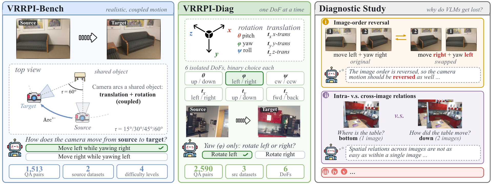

<div align="center" style="font-family: charter;">

<h1><i> Lost in Space?</i></br> A Diagnostic Study of Cross-View Camera-Motion Identification in VLMs</h1>

<a href="https://arxiv.org/abs/2601.22228" target="_blank"></a>
<a href="https://huggingface.co/datasets/kdeng03/VRRPI-Bench-V2" target="_blank"></a>
<a href="https://huggingface.co/datasets/kdeng03/VRRPI-Diag-V2" target="_blank"></a>

<div>
    <a href="https://github.com/kdeng-gzcn" target="_blank">Ken Deng</a><sup>1, 2</sup>&emsp;
    <a href="https://github.com/yfqiu-nlp" target="_blank">Yifu Qiu</a><sup>1</sup>&emsp;
    <a href="https://ykasten.github.io/" target="_blank">Yoni Kasten</a><sup>3</sup>&emsp;
    <a href="https://homepages.inf.ed.ac.uk/scohen/" target="_blank">Shay B. Cohen</a><sup>1</sup>&emsp;
    <a href="https://yftah89.github.io/" target="_blank">Yftah Ziser</a><sup>3</sup>
</div>

<div>
    <sup>1</sup>University of Edinburgh&emsp;
    <sup>2</sup>University of Oxford&emsp;
    <sup>3</sup>NVIDIA Research&emsp;
    <!-- <sup>4</sup>University of Groningen&emsp; -->
</div>

---

<table width="100%" cellspacing="0" cellpadding="0">
    
</table>

Single-image spatial reasoning is handled well, but whether vision-language models (VLMs) carry that competence across viewpoints remains unclear. We formulate cross-view camera-motion identification, named visual reasoning relative pose identification (VRRPI): given an ordered pair of views, a model selects the motion relating them, with ground truth derived from calibrated poses. We build two benchmarks from indoor RGB-D scans: VRRPI-Bench ($1{,}513$ pairs) tests coupled object-centric motion, in which translation and yaw occur together, while VRRPI-Diag ($2{,}590$ pairs) isolates one rotation or translation factor at a time. Across fourteen VLMs the two regimes separate sharply. On VRRPI-Diag, isolated factors are close to solved, with the three proprietary models at $0.96$--$1.00$ overall. On VRRPI-Bench, the same models reach $0.74$--$0.90$ Macro-F1, whereas nine of the eleven open-weight models score at or below the $0.48$ chance level. The deficit is structured: open-weight models do not bind image order, and six of the fourteen degrade when the object's ground-truth displacement is supplied, consistent with mapping displacement directly to camera motion rather than inverting it, recovering once the inverse relation is stated. With factor, viewpoint angle, and input order controlled, scores read as a profile of where cross-view reasoning breaks rather than a single ranking.

Want to compete with VLMs? Try with our [Human Evaluation Google Form](https://forms.gle/3TMuQpETQSz92vHf6).

</div>

## Contents

- [Quick Example](#quick-example)
- [Environment Setup](#environment-setup)
- [\[Optional\] Prepare Benchmark](#optional-prepare-benchmark)
  - [Step1: Download Dataset](#step1-download-dataset)
- [Comprehensive Evaluation](#comprehensive-evaluation)
- [Citation](#citation)

## Quick Example

```python
from datasets import load_dataset, Dataset
from hydra import compose, initialize

from src.infer import InferEngine


def prepare_vrrpi_bench() -> Dataset:
    raw_dataset = load_dataset("kdeng03/VRRPI-Bench-V2", split="train")

    assert "images" in raw_dataset.column_names, "Dataset must contain 'images' column"
    assert "demo_prompt" in raw_dataset.column_names, "Dataset must contain 'demo_prompt' column"

    def preprocess(row):
        images = row["images"]
        prompt = row["demo_prompt"]

        image_shapes = [image.size for image in images]
        return {
            "image_shapes": image_shapes,
            "prompt": prompt
        }

    raw_dataset = raw_dataset.map(preprocess)
    return raw_dataset


vrrpi_bench = prepare_vrrpi_bench()

with initialize(config_path="configs", version_base=None):
    cfg = compose(config_name="main")

engine = InferEngine(cfg) # Default model is qwen3_vl_8b_i, you can change it in configs/main.yaml
responses: Dataset = engine.dry_run(vrrpi_bench)
engine.close()

# Check
for idx, row in enumerate(responses):
    print(f"🌀🌀 Record {idx}: {row['raw_response']}")
```

```log
🌀🌀 Record 0: Move right while yawing left
🌀🌀 Record 1: Move right while yawing left
🌀🌀 Record 2: Move right while yawing left
🌀🌀 Record 3: Move right while yawing left
🌀🌀 Record 4: Move right while yawing left
```

## Environment Setup

Before everything, confirm that you are under the project directory and prepare the environment:
```bash
cd /path/to/lost-in-space-v2
bash setup.sh # The core inference engine needs `vllm`, `openai`, `open-cv` and 'kornia' in your environment.
```
> Expected output: a conda environment named `sr` with packages mentioned in `requirements.txt`

## [Optional] Prepare Benchmark

We already published our benchmarks, if you are interested in how we curate our benchmarks, please refer to [the previous repo](https://github.com/kdeng03/lost-in-space), we only introduce how to download the source datsets here.


### Step1: Download Dataset

To download the datasets:

1. **[7 Scenes](https://www.microsoft.com/en-us/research/project/rgb-d-dataset-7-scenes/)** is provided for non-commercial use only. By downloading the data, you accept the [license agreement](https://www.microsoft.com/en-us/research/wp-content/uploads/2016/02/7-scenes-msr-la-dataset-7-scenes.rtf). The command for downloading is as follows:

      ```bash
      bash data/rgb-d-dataset-7-scenes/download.sh
      ```
      > Expected output: `data/rgb-d-dataset-7-scenes/*` for raw data from 7 Scenes

2. To use **[ScanNet](http://www.scan-net.org/)**, please fill out an agreement to the [ScanNet Terms of Use](http://kaldir.vc.cit.tum.de/scannet/ScanNet_TOS.pdf), using your institutional email addresses, and send it to <scannet@googlegroups.com>. Then you can recieve the scripts for downloading, please make sure to put `download-scannet.py` under `data/scannet-v2`:
      ```bash
      # Ensure download-scannet.py exists
      git clone https://github.com/ScanNet/ScanNet.git
      bash data/scannet-v2/download.sh # Download data
      bash data/scannet-v2/reader.sh # Parse images
      ```
      > Expected output: `data/scannet-v2/*` for raw data from ScanNet

3. For **[ScanNet++](https://scannetpp.mlsg.cit.tum.de/scannetpp/)**, please [create an account](https://scannetpp.mlsg.cit.tum.de/scannetpp/register), login and create an application. Once your application is approved, you will receive a personalized token to download the data along with further instructions. Please confirm that you put `download_scannetpp.py` under `data/scannetpp`:
      ```bash
      # Ensure download_scannetpp.py exists and set your token in the download_scannetpp.yml
      python data/scannetpp/download_scannetpp.py data/scannetpp/download_scannetpp.yml 
      ```
      > Expected output: `data/scannetpp/*` for raw data from ScanNet++


## Comprehensive Evaluation

We use `hydra` to configurate our experiments. For models, we provide LLMs with different backend: 1) `vllm`, 2) `openai` (async) and 3) `anthropic` (async). 

If you want to add new models, please register your model in `configs/models/your_model.yaml`, here is an example of `GPT-6-Astra`:
```yaml
name: gpt_6_astra
engine: openai_responses
modality: mllm

sdk_init_kwargs:
  api_key: api_key
  base_url: base_url

sampling_params_kwargs:
  model: gpt-6-astra
  max_output_tokens: 1024
```


To repoduce our results, you can easily modify and run `bash scripts/eval.sh`. Here is an example config:
```bash
# scripts/eval.sh

models=gpt_6_astra,gemini_4_argon
eval=vrrpi_bench

log_dir=logs/eval_${eval}
mkdir -p ${log_dir}

python -m scripts.main.eval --multirun models=${models} eval=${eval} 2>&1 | tee ${log_dir}/${models}.log
```

We provide the following models and evaluations (pass the config name to `models=` / `eval=`):

**Models** (`configs/models/`)

| Config name | Backend (`engine`) | Checkpoint / API model | Thinking |
|---|---|---|---|
| `gpt_6_astra` | `openai_responses` | `gpt-6-astra` | ✓ |
| `gemini_4_argon` | `openai_chat_completions` | `gemini-4-argon` | ✓ |
| `gemini_3.1_pro` | `openai_chat_completions` | `gemini-3.1-pro-preview` | ✓ |
| `gemini_3.8_flash` | `openai_chat_completions` | `gemini-3.8-flash` | ✓ |
| `qwen3_vl_8b_i` | `vllm_offline` | `Qwen/Qwen3-VL-8B-Instruct` | ✗ |
| `qwen3_vl_8b_t` | `vllm_offline` | `Qwen/Qwen3-VL-8B-Thinking` | ✓ |
| `qwen3_vl_32b_i` | `vllm_offline` | `Qwen/Qwen3-VL-32B-Instruct` | ✗ |
| `qwen3_vl_32b_t` | `vllm_offline` | `Qwen/Qwen3-VL-32B-Thinking` | ✓ |
| `qwen3.8_27b` | `vllm_offline` | `Qwen/Qwen3.8-27B` | ✗ |
| `qwen3.8_27b_t` | `vllm_offline` | `Qwen/Qwen3.8-27B` | ✓ |
| `gemma_4_31b_it` | `vllm_offline` | `google/gemma-4-31B-it` | ✗ |
| `gemma_4_31b_it_t` | `vllm_offline` | `google/gemma-4-31B-it` | ✓ |
| `glm_4.6v_flash` | `vllm_offline` | `zai-org/GLM-4.6V-Flash` | ✗ |
| `glm_4.6v_flash_t` | `vllm_offline` | `zai-org/GLM-4.6V-Flash` | ✓ |
| `sensenova_si_1.1` | `vllm_offline` | `sensenova/SenseNova-SI-1.1-Qwen3-VL-8B` | ✗ |
| `sift` | `sift` | Classical SIFT feature-matching baseline | – |
| `loftr` | `loftr` | LoFTR feature-matching baseline | – |

**Evaluations** (`configs/eval/`)

| Config name | Dataset (HF) | Description |
|---|---|---|
| `vrrpi_bench` | [`kdeng03/VRRPI-Bench-V2`](https://huggingface.co/datasets/kdeng03/VRRPI-Bench-V2) | Main benchmark: coupled object-centric motion |
| `vrrpi_diag` | [`kdeng03/VRRPI-Diag-V2`](https://huggingface.co/datasets/kdeng03/VRRPI-Diag-V2) | Diagnostic benchmark: isolated single-factor motion |
| `vrrpi_bench_cv` | `kdeng03/VRRPI-Bench-V2` | VRRPI-Bench with classical CV baselines (`sift`, `loftr`) |
| `resolution_ablation` | `kdeng03/VRRPI-Bench-V2` | Input image resolution ablation |
| `reversal_ablation` | `kdeng03/VRRPI-Bench-V2` | Image-order reversal ablation |
| `ea_i` | `kdeng03/intra-image-sr` | Extended analysis I: single-image spatial reasoning |
| `ea_ii` | `kdeng03/cross-image-sr` | Extended analysis II: cross-image spatial reasoning |
| `ea_iii` | `kdeng03/ablation-VRRPI-Diag` | Extended analysis III: VRRPI-Diag ablation |

Multiple configs can be swept at once with comma-separated lists, e.g. `models=qwen3_vl_8b_i,qwen3_vl_8b_t eval=vrrpi_bench,vrrpi_diag`.


## Citation
If you find our paper and code useful in your research, please cite our paper using the following BibTeX :)
```bibtex
@misc{deng2026lostspacevisionlanguagemodels,
      title={Lost in Space? Vision-Language Models Struggle with Relative Camera Pose Estimation}, 
      author={Ken Deng and Yifu Qiu and Yoni Kasten and Shay B. Cohen and Yftah Ziser},
      year={2026},
      eprint={2601.22228},
      archivePrefix={arXiv},
      primaryClass={cs.CV},
      url={https://arxiv.org/abs/2601.22228}, 
}
```
